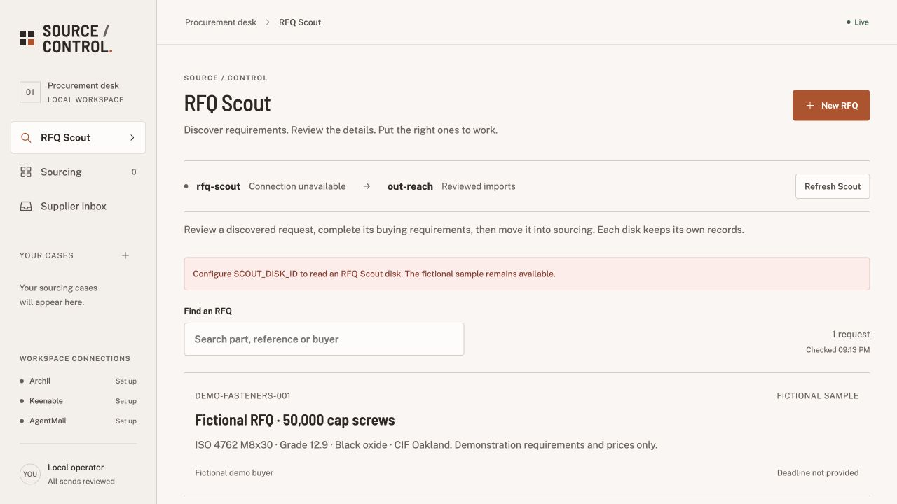

# Source / Control

**From an RFQ to sourced suppliers and reviewed negotiations.**

One local procurement dashboard combines full-document RFQ upload, RFQ Scout, parallel manufacturer research, source evidence, and a supplier inbox. Archil stores the work and runs verification beside the saved evidence. The operator reviews buying requirements and approves every real outgoing email.



*Public example only. Your own credentials and disks enable live research and inbox monitoring.*

## What runs

- **RFQ intake:** upload a searchable PDF or UTF-8 text document, review extracted product lines and their source quotations, and select the lines to source.
- **Research:** Keenable search and live fetches feed English and Mandarin Codex workers in parallel.
- **Verification:** parallel Archil executions check contacts, fingerprint snapshots, and prepare grounded supplier candidates.
- **Negotiation:** three shared worker slots process supplier replies, with one reviewed price counteroffer per supplier.
- **Recovery:** durable receipts and decisions survive restarts; duplicate messages and uncertain sends are reconciled.
- **One desk, two disks:** Scout records are read-only inputs; reviewed cases, evidence, and negotiations belong to the outreach disk.

```text
apps/outreach/        Unified dashboard, orchestrator, integrations, tests
apps/rfq-scout/       Producer handoff; original source not yet included
docs/architecture.md
```

> **Scout producer source is not included yet.** The unified app already reads published Scout records from a separate Archil disk; its read adapter is not the producer that discovers and publishes RFQs. Add the cofounder’s original source under [apps/rfq-scout](apps/rfq-scout/) in this repository when available. Manual RFQ entry and the fictional sample review work independently. Feed contents depend on the configured disk, records, and access permissions.

## Run locally

Requires **Node.js ≥22.19**, an installed **Codex CLI authenticated with `codex login`**, Archil access, and Keenable access/credits for live research. AgentMail is optional. Models run through your local Codex authentication; this version uses neither Bedrock nor a separate model API key.

From the repository root:

```sh
npm run setup
cp -n apps/outreach/.env.example apps/outreach/.env
# Configure the local environment file.
npm run build
npm run check:setup
npm start
```

Open [localhost:4310](http://127.0.0.1:4310). Root scripts delegate to `apps/outreach`; setup does not install Codex CLI. For development, run `npm run dev` and `npm run dev:web` in separate terminals. The Vite UI uses port `4311`.

Either founder can follow the [cofounder startup guide](docs/cofounder-startup.md). Choose **one backend owner** for a shared outreach disk and prefix; do not start a second backend against the same state. The repository shares code and the disks share data. Remote access is not configured: the localhost URL works on the host running the app. When private hosting is configured, both founders use that one backend's authenticated URL.

`npm run check:setup` checks Node, installed dependencies, build files, Codex availability/login, and configuration presence without printing credential or disk-ID values. It makes no service API calls and does not start the app. Permissions, credits, model inference and exclusive backend ownership still need verification during operation.

See [.env.example](apps/outreach/.env.example). Set `ARCHIL_API_KEY`, `ARCHIL_REGION`, and an `ARCHIL_DISK_ID` your account can access. `ARCHIL_PREFIX` isolates outreach records. `SCOUT_DISK_ID` selects the separate published-input disk. The repository does not grant access to the team's disks.

```sh
npm run connect:keenable
# Optional, for real email:
npm run connect:email
```

These helpers save keys locally without displaying them. Keenable linking and available credits are separate prerequisites. For AgentMail, obtain a key from its [console](https://console.agentmail.to); select **Connect inbox** to provision a dedicated inbox, or configure an existing `AGENTMAIL_INBOX_ID`. Keep credentials in the ignored environment file.

## Use it

1. **Upload and review an RFQ**, select a Scout request, or choose **New RFQ**. An upload can contain multiple products: review the source quotations and select the lines you want. Each selected line becomes its own sourcing case.
2. **Start sourcing.** Research can use known requirements while missing values remain `null`. Inspect the returned evidence and uncertainties. A run can return fewer than three suppliers when evidence is insufficient; no manufacturers are invented to fill the shortlist.
3. **Choose communications.** Missing fields remain open for supplier clarification in reviewed RFQ emails. Demo controls inject explicitly simulated quotes. **Prepare email outreach** creates a separate real-email case with editable drafts. Buyer contacts from Scout are never treated as supplier addresses.
4. **Review each send.** Save changes, then approve the exact recipient and saved message. Replies can generate a clarification or one counteroffer, each requiring approval. A target-met result is a recommendation, not an accepted purchase.

The backend monitors tracked email threads while running. Unknown sends are reconciled instead of blindly resent. Retain both Archil state and local delivery-operation records across restarts. This app does not place orders or make payments.

Uploads accept searchable PDF and UTF-8 `.txt` files up to **10 MB**, with at most **100 PDF pages** and **400,000 extracted text characters**. The original is saved to Archil before extraction. Non-null extracted buying fields require supporting source quotations; missing terms and budgets are not filled with demo values. Scanned PDFs need OCR before upload; OCR is not built in. See [document intake](apps/outreach/README.md#upload-a-complete-rfq) for the review flow and API.

## Rehearse a 90-second demo

First connect the services and capture a real research run. For three concurrent negotiations, prepare a case with three sourced suppliers and idle worker slots.

1. Show an RFQ's source fingerprint and the prepared supplier shortlist.
2. Open **Demo**, enable **Hold queue 5s**, and inject initial quotes. Show the durable pending receipt; stop and restart the backend during the hold window.
3. Expand **Agent activity** to show resumed work and concurrent negotiations.
4. Inject a duplicate and the Grade 8.8 substitution: expect deduplication and `needs attention`.
5. Inject the final `$0.064` reply: matching terms can reach `target met`; unresolved delivery requirements remain visible.

Fastener prices and replies in this sequence are fictional; no external email is sent. Ninety seconds is a presentation target, not a latency guarantee. **Replay saved evidence** reuses a prior run's snapshots with original timestamps while synthesis and Archil verification run again. Saved research is not bundled or represented as fresh search.

## Validate and inspect

```sh
npm run typecheck
npm test
npm run build
```

The validation commands cover setup diagnostics, application tests, TypeScript checking and the production build. Setup tests use mocked configuration and a bounded local child process; they do not contact service APIs.

Tests use synthetic fixtures and fake email transport for scheduling, grounding, source revisions, approval, deduplication, and recovery. They do not prove that a real supplier exchange occurred.

Read [the architecture](docs/architecture.md) for data flow and boundaries, [the app README](apps/outreach/README.md) for operating details, and [shared contracts](apps/outreach/shared/) for integration types.
