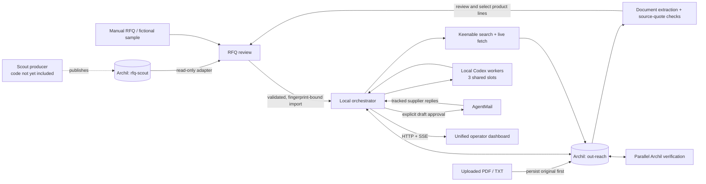

# Architecture

Source / Control runs one local Node/Express orchestrator and React dashboard. The browser uses HTTP and server-sent events; research and email credentials remain on the server. Codex processes run locally against supplied evidence. Archil is the shared persistent data layer and the execution environment for evidence verification.

## One dashboard, two disk owners



`rfq-scout` owns published discovery records. `out-reach` owns reviewed requirements, supplier evidence, conversations, decisions, and recovery records. Disks do not coordinate themselves: the local backend performs the handoff. No source records are migrated or changed.

The Scout adapter exposes reads only and accepts a bounded index plus validated record paths. This is an application-level restriction, not a separate provider IAM policy. Access still requires an Archil credential authorized for that disk. The producer that publishes these records belongs in `apps/rfq-scout`; its implementation is not part of this submission yet.

## RFQ handoff

The adapter reads `rfqs/latest.json` and the indexed `rfqs/open/<id>.json` records. It maps only supported fields into a partial requirement. It does not combine multiple product lines, turn bid deadlines into delivery dates, invent price limits, or reuse buyer contacts for manufacturer outreach.

The operator completes the requirement in the shared review form. `POST /api/scout/import` receives the reviewed RFQ and `{ id, sha256 }` source reference. The backend reloads the source, rejects changed revisions, validates the requirement, and preserves the source snapshot before creating an outreach case. Identical import retries reuse a deterministic case. The source fingerprint and the saved snapshot fingerprint have distinct meanings and remain attached to later evidence replays and email cases.

Scout import alone neither launches research nor sends email. **Save & start sourcing** makes a separate start request after import succeeds. Manual case creation uses the same RFQ contract without a Scout dependency.

Document uploads are another input to this dashboard. The backend saves the exact PDF/TXT bytes, fingerprint and receipt to the outreach disk before parsing and model extraction. Searchable documents are bounded at 10 MB, 100 PDF pages and 400,000 text characters. Extracted buying fields must have matching source-page quotations; unsupported values become `null`. Document requirements and unreadable-page warnings remain visible. There is no built-in OCR, and scanned documents need a searchable replacement.

Review and line selection precede case creation. Each selected product becomes a separate case with its document provenance; an import may also request research. Research uses known requirements without substituting demo specifications or budgets. Required missing fields block email outreach and negotiation, while the delivery date remains a distinct uncertainty. Upload receipt recovery resumes unfinished extraction after a restart.

## Parallel research and verification

1. The orchestrator starts `sourcing-en` and `sourcing-zh` concurrently, using the actual RFQ. Keenable receives the directory exclusion list at search time. Excluding named sites does not prove that the remaining results are manufacturers.
2. Each track selects up to five distinct URLs and requests both live raw markdown and prompted extraction. Direct HTTP fetches explicitly supply `live`, `max_chars`, and `prompt`; prompted extraction is advisory.
3. Raw snapshots, fetch metadata, retrieval times, truncation flags, and extraction results are persisted under unique case/attempt paths **before** synthesis.
4. Two local Codex workers synthesize their respective saved evidence. Worker browsing and tools are disabled. Inputs are bounded structured data; website and email text is treated as untrusted content.
5. Two top-level `archil.exec` jobs verify the tracks in parallel. Each mounts scripts and source input read-only, plus a separate conditional output subdirectory. The installed TypeScript mount field is `disk`.
6. The verifier checks contacts and evidence against the captured sources, hashes the exact markdown bytes, normalizes identities, and removes unsupported claims. The evaluator receives the grounded results and forms a conservative shortlist.

This gives Archil execution actual data-plane work: the verification code runs beside persisted source files rather than asking a model to certify its own output. SHA-256 values are **snapshot fingerprints**, not proof that a website's claims are true. Truncation or missing text produces uncertainty; weak identity similarities do not justify merging factories.

Keenable searches and fetches are real when a live run executes. Counts, reported usage, and measured durations come from those operations. Replays reuse existing snapshots and retain their original timestamps; no network or inference latency is guaranteed.

## Shared scheduling and state ownership

A global priority scheduler permits at most three local Codex processes. Inbound quote extraction and counteroffers take priority over queued sourcing and evaluation. Scheduling is non-preemptive: a running worker finishes before its slot can be reassigned.

Different suppliers can negotiate concurrently; each supplier's messages are serialized. The orchestrator is the only writer of consolidated case, offer, and conversation projections. Per-case locks cover fresh reads, merges, and durable commits, not model inference. Strict schemas are checked before invocation and returned JSON is validated again.

This deployment supports **one backend process**. Its in-memory queues and mutexes are not distributed coordination for multiple server replicas.

## Inbox durability and recovery

Incoming simulated replies are persisted before HTTP `202` or the receipt event. Identical message-ID retries reuse the record; conflicting payloads are rejected. Email ingestion also preserves provider data before model processing.

A complete immutable decision is saved before its conversation, offer, outbox/draft, and case projections. Restart reconciliation scans durable incoming records and decisions, then finishes missing projections. A saved decision avoids repeating inference. A crash before decision persistence may require inference again.

Deterministic simulated outbound IDs enforce the initial RFQ and one-counteroffer policy. Email handling orders replies per supplier and preserves newer state while reconciling older unfinished work. The five-second hold is a demonstration aid after durable receipt, not an alternate storage mechanism.

## Real email is reviewed, not autonomous sending

Research cases and real-email cases are separate. Preparing outreach copies the selected suppliers into a new email case with empty negotiation history. Simulation endpoints reject real-email cases, and the UI hides simulated reply controls there.

Every outgoing RFQ, clarification, and counteroffer is an editable local draft. Approval supplies the saved revision and content hash. The backend checks that the recipient and exact content still match before creating a durable approval intent. Unsaved changes, stale revisions, or superseding supplier replies invalidate approval.

AgentMail uses a dedicated inbox. An inbox is provisioned only through the explicit connection action unless an existing inbox is configured. The adapter stores local operation records and sends approved content with a stable idempotency key. Archil records the intent, attempt, receipt, and resulting projections. An ambiguous result becomes `send unknown`; reconciliation searches for the matching sent message and does not blindly retry a send. Provider acceptance does not guarantee recipient delivery. AgentMail may append its service footer, as disclosed in the review UI.

While the backend runs, polling examines only tracked supplier threads and processes unseen messages. AgentMail's thread response includes bodies; this is not metadata-only polling. Supplier-authored evidence must support extracted terms. Incomplete, conditional, alternative, truncated, or attachment-only offers require clarification or attention. Prior terms cannot be borrowed from an unconfirmed or negative reply. The one-price-counteroffer limit remains in force; final offers are recommendations, never purchase acceptance.

## Storage boundaries

The outreach adapter namespaces application objects under `ARCHIL_PREFIX`, defaulting to `autonomous-sourcing/v1/`. A representative case includes:

```text
cases/<caseId>/
  state.json
  research/<attemptId>/...  research evidence and verification inputs/outputs
  inbox/incoming/...       durable incoming messages
  decisions/...            saved model/policy decisions
  conversations/...        per-supplier projections
  offers/...               latest offer projections
  processed/...            completed processing markers
  email/...                reviewed drafts, intents, attempts, receipts, source evidence
```

Specific evidence paths are unique per attempt. Existing unrelated disk files are not overwritten. Immutable records are enforced by the application store abstraction; projections are intentionally mutable.

Uploaded originals, receipts, extraction results and status live under `rfq-uploads/<uploadId>/` in the same outreach namespace. They are private application data, not repository assets. Selected-line imports preserve the source fingerprint and extraction evidence in each resulting case.

The local `.env`, Codex authentication, and ignored `work/auth/` records are outside published source and worker inputs. Outreach raw email and evidence records are application data on the configured disk. Keep both the local delivery-operation records and the Archil journal when restarting or moving the local deployment.

`APP_STORAGE=file` is an explicit test adapter. The app does not silently substitute local storage when Archil fails.

## Interfaces and validation

The React client uses `/api/cases`, `/api/scout`, `/api/rfq-uploads` and `/api/email`; `/api/events` carries runtime snapshots and operational events. Upload APIs accept raw document bodies, expose extraction status/original downloads, and import selected lines with an explicit research-start choice. See the app README for endpoint details and `apps/outreach/shared/` for the TypeScript contracts.

Tests use isolated stores and fake providers for concurrency, strict schemas, grounding, false merges, stale imports, duplicate/conflicting messages, exact email approval, and partial-write recovery. Real connection rehearsals are separate from these automated tests.

Current scope is a local procurement workflow with one product line per case; uploaded documents may supply multiple cases. The Scout producer is pending; feed availability depends on external records and permissions. The app does not assess government procurement eligibility, submit bids, independently certify factories, accept orders, or move money.
